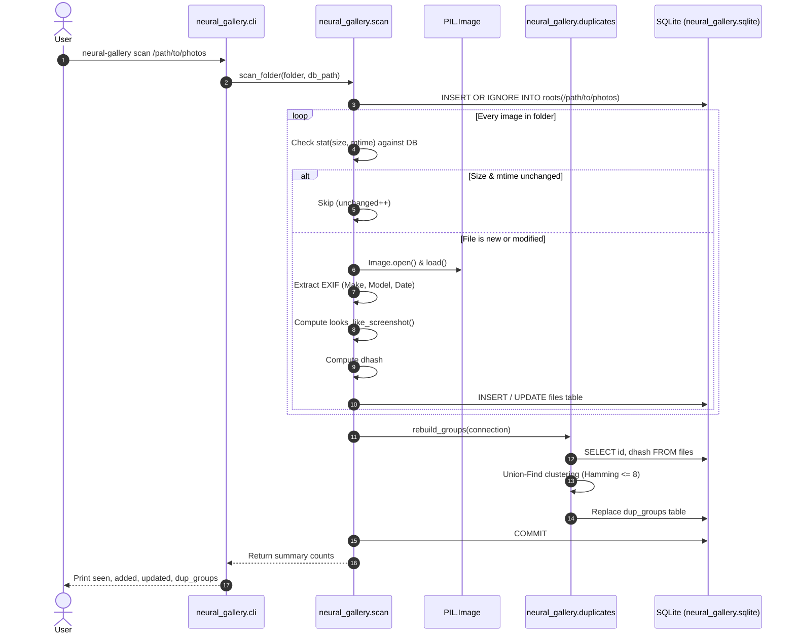
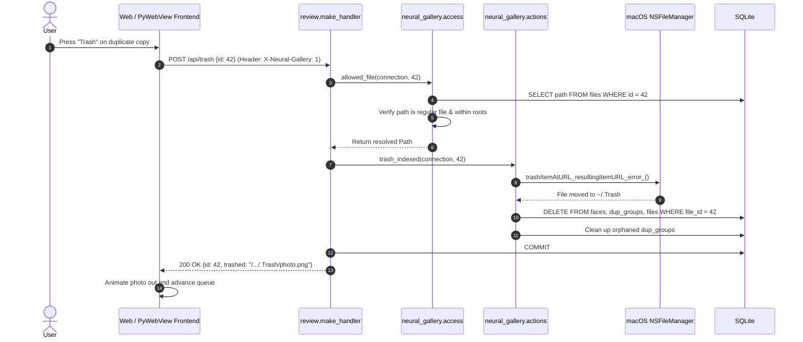

# System Architecture & Technical Design

This document details the software architecture, subsystem interactions, and platform-specific engineering of **Neural Gallery** (v0.2.0).

---

## 1. Architectural Philosophy & Guiding Tenets

1. **Local-Only & Air-Gapped Operation:** All scanning, perceptual hashing, face detection, and review operations run strictly on the local machine. The HTTP server binds exclusively to `127.0.0.1`. No data or telemetry leaves the device.
2. **Non-Destructive by Default:** The scanning process is strictly read-only. File modifications, folder moves, or deletions occur only after explicit user confirmation in the review interface. Deletions always route to macOS Finder Trash via Cocoa's `NSFileManager`—files are never permanently purged via `unlink`.
3. **Native macOS Integration:** Rather than shipping a heavy multi-process Electron runtime, Neural Gallery integrates directly with macOS APIs via PyObjC (`Foundation`, `AppKit`, and `Vision`), achieving lightweight native window controls, transparent titlebars, and hardware-accelerated computer vision.
4. **Zero-Dependency Frontend:** The UI is an embedded single-page application (HTML/CSS/vanilla JS) delivered directly from `neural_gallery/review.py`, eliminating Node.js build pipelines and external web assets.

---

## 2. High-Level Subsystem Breakdown

```
┌────────────────────────────────────────────────────────────────────────┐
│                          neural_gallery.cli                            │
│         Orchestrates subcommands: scan, stats, faces, app, serve       │
└───────────────┬────────────────────────────────────────┬───────────────┘
                │                                        │
                ▼                                        ▼
┌──────────────────────────────┐        ┌────────────────────────────────┐
│     neural_gallery.scan      │        │     neural_gallery.desktop     │
│ Crawls directories, extracts │        │ PyWebView window wrapper with  │
│ EXIF, computes dhash, caches │        │ native AppKit borderless style │
└───────────────┬──────────────┘        └────────────────┬───────────────┘
                │                                        │
                ▼                                        ▼
┌──────────────────────────────┐        ┌────────────────────────────────┐
│  neural_gallery.duplicates   │        │     neural_gallery.review      │
│ Union-Find clustering and    │        │ Localhost ThreadingHTTPServer  │
│ Banded LSH near-duplicates   │        │ and embedded SPA web interface │
└───────────────┬──────────────┘        └────────────────┬───────────────┘
                │                                        │
                ▼                                        ▼
┌──────────────────────────────┐        ┌────────────────────────────────┐
│     neural_gallery.faces     │        │ neural_gallery.actions & access│
│ Apple Vision face detection  │        │ Sandboxed path resolution and  │
│ and feature print clustering │        │ Finder Trash via NSFileManager │
└───────────────┬──────────────┘        └────────────────┬───────────────┘
                │                                        │
                └───────────────────┬────────────────────┘
                                    │
                                    ▼
                        ┌───────────────────────┐
                        │   neural_gallery.db   │
                        │ SQLite in WAL mode    │
                        │ Mode 0600 permissions │
                        └───────────────────────┘
```

---

## 3. Subsystem Deep Dive

### 3.1. Ingestion & Scanning Subsystem (`neural_gallery.scan`)

The scanner recursively crawls directory paths without following symbolic links:
* **Format Filtering:** Restricts ingestion to supported raster formats: `.jpg`, `.jpeg`, `.png`, `.webp`, `.gif`, `.tif`, `.tiff`.
* **Stat Cache Invalidation:** Compares file `size` and modification time (`mtime`) against the `files` table. Unchanged files bypass decoding and perceptual hashing, reducing re-scan durations to milliseconds.
* **EXIF Metadata Extraction:** Reads EXIF flags using Pillow (`_exif_flags`). It checks tag `271` (Make), `272` (Model), and `36867` (`DateTimeOriginal`, including nested `0x8769` EXIF IFD).
* **Screenshot Detection Heuristic:** Evaluates whether an image is a screenshot based on filename substrings (`"screenshot"`, `"screen shot"`) or file characteristics (PNG format, lack of camera metadata, and display aspect ratios in the $[1.7, 2.4]$ range).
* **Perceptual Hashing:** Generates a 64-bit difference hash (`dhash`) using `imagehash`.
* **Batch Commits:** Flushes database insertions/updates in transactions every 200 items to maintain database responsiveness and prevent memory spikes.

### 3.2. Perceptual Duplicate Engine (`neural_gallery.duplicates`)

The duplicate engine identifies near-identical photos (e.g., burst shots, slight edits, re-encodings) using the 64-bit difference hash:
* **Hamming Metric:** Measures bitwise distance: $\Delta_H(a, b) = \text{popcount}(a \oplus b)$. Pairs with $\Delta_H \le 8$ are considered duplicates.
* **Union-Find Clustering:** Uses disjoint-set union with path compression (`find` and `union`) to cluster transitively connected duplicates.
* **Dual-Mode Complexity Scaling:**
  * When total hashed files $N \le 8,000$: Performs exhaustive $O(N^2)$ pairwise comparisons.
  * When $N > 8,000$: Employs **Banded Locality-Sensitive Hashing (LSH)** (`_union_banded`). Hashes are partitioned into four 16-bit bands (shifts at 48, 32, 16, 0). Photos sharing identical 16-bit slices are evaluated. Buckets exceeding 400 candidates are skipped to avoid pathological clustering.

### 3.3. Apple Vision Face Recognition Pipeline (`neural_gallery.faces`)

Face detection and clustering run on-device via Apple's native Vision framework:
1. **Bounding Box Detection:** `_detect_boxes` passes the image URL to `VNDetectFaceRectanglesRequest`. Vision outputs normalized coordinates $[0.0, 1.0]$ with an **inverted bottom-left origin**.
2. **Crop Transformation:** `crop_box` converts Vision's coordinate system to PIL's top-left pixel space while applying a 25% contextual padding border.
3. **Feature Print Extraction:** `_feature_print` converts cropped face patches into JPEG byte buffers and queries `VNGenerateImageFeaturePrintRequest`. It extracts normalized 512-dimensional `float32` vectors.
4. **Centroid-Based Online Clustering:** `assign_people` compares feature vectors against running centroids using cosine distance:
   $$d(\mathbf{u}, \mathbf{c}) = 1.0 - (\mathbf{u} \cdot \mathbf{c})$$
   Embeddings within threshold $0.34$ are merged into existing person clusters; otherwise, a new cluster key (`p<face_id>`) is spawned.

### 3.4. Heuristic Suggestion Engine (`neural_gallery.learn`)

Rather than maintaining heavy machine learning dependencies, Neural Gallery employs a lightweight 1-Nearest Neighbor (1-NN) heuristic on difference hashes:
* Extracts sets of known `keep` and `noise` hashes from user-labeled images.
* Calculates minimum Hamming distances: $d_{keep}$ and $d_{noise}$.
* Applies a margin boundary (`MARGIN = 4`):
  * If $d_{noise} + 4 < d_{keep}$, suggests `noise`.
  * If $d_{keep} + 4 < d_{noise}$, suggests `keep`.
  * Unlabeled screenshots with no similar `keep` examples automatically suggest `noise`.

### 3.5. Security, Sandboxing & Action Dispatcher (`neural_gallery.access`, `neural_gallery.actions`)

To guarantee that file manipulations remain safe and authorized:
* **Path Sandboxing:** `allowed_file(connection, file_id)` ensures the requested file ID exists, resolves to a regular file (rejecting symlinks), and resides within an indexed folder in the `roots` table.
* **Safe Trashing:** `trash_file` invokes Cocoa's `NSFileManager.defaultManager().trashItemAtURL_resultingItemURL_error_()`, transferring files to the user's macOS Finder Trash.
* **Safe Movement:** `move_indexed` verifies destination directories, avoids name collisions via `_unique_target`, executes `shutil.move()`, registers the destination in `roots`, and updates SQLite metadata.
* **Finder Reveal:** `reveal` triggers `open -R <path>` to highlight the file directly in Finder.

### 3.6. Presentation Layer (`neural_gallery.desktop`, `neural_gallery.review`)

Neural Gallery provides both desktop and web-based interaction:
* **HTTP Review Server:** An instance of `http.server.ThreadingHTTPServer` bound to `127.0.0.1` serving a single-page application and JSON endpoints.
* **Native Desktop Chrome:** When launched via `neural-gallery app`, `neural_gallery.desktop` wraps the web app using `pywebview` with Cocoa (`gui="cocoa"`). It customizes the `NSWindow` style mask:
  * Applies `NSFullSizeContentViewWindowMask` and `NSWindowTitleHidden`.
  * Preserves native macOS traffic light buttons (Close, Miniaturize, Zoom).
  * Implements borderless dragging in the top band ($x > 78\text{px}$, $\text{top} \le 36\text{px}$).
  * Intercepts `NSEvent` keydown events to route Left/Right arrow navigation directly into the JavaScript canvas.
  * Observes `AppleInterfaceThemeChangedNotification` to dynamically sync window backgrounds with macOS Dark Mode.

---

## 4. Sequence Workflows

### 4.1. Ingestion Workflow (`neural-gallery scan <folder>`)



### 4.2. Review & Trashing Workflow (`neural-gallery app` / `neural-gallery serve`)



---

## 5. Concurrency & Process Model

* **Process Architecture:** Neural Gallery operates as a single OS process with multithreaded dispatch.
* **Web Server Concurrency:** `ThreadingHTTPServer` spawns a worker thread per incoming HTTP request. Because SQLite connections cannot be shared across threads, each HTTP request opens and closes its own thread-confined connection using `connect(db_path)`.
* **Database Concurrency:** SQLite is configured with Write-Ahead Logging (`PRAGMA journal_mode = WAL`), allowing concurrent readers to execute without blocking writers.
* **Desktop Event Loop:** When running `neural-gallery app`, the Cocoa AppKit runloop owns the main thread. Background HTTP requests and timer dispatches bridge to AppKit using `PyObjCTools.AppHelper.callAfter`.

