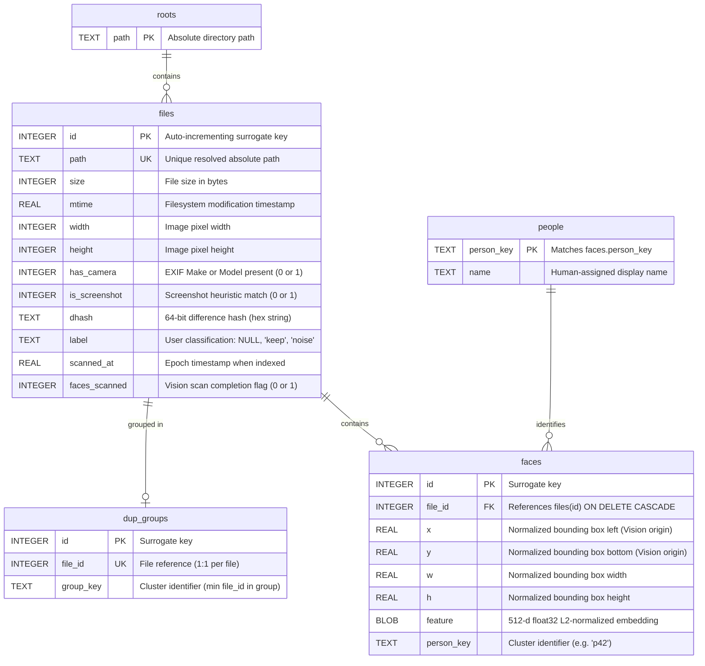

# Database Schema & Data Models

This document specifies the persistence architecture, table definitions, relational constraints, indexing strategies, and query patterns for Neural Gallery's SQLite index.

---

## 1. Storage & Operational Parameters

* **Default Location:** `~/Library/Application Support/Neural Gallery/neural_gallery.sqlite`
* **File Permissions:** Created and strictly maintained with POSIX mode `0600` (`-rw-------`). Associated SQLite journal sidecars (`neural_gallery.sqlite-wal` and `neural_gallery.sqlite-shm`) are also enforced at mode `0600`.
* **Umask Protection:** Connections are initiated under an explicit process umask of `0077` (`os.umask(0o077)`) to prevent world/group readability.
* **Pragmas Configured on Connect:**
  * `PRAGMA foreign_keys = ON;` — Enforces relational integrity across tables.
  * `PRAGMA journal_mode = WAL;` — Enables Write-Ahead Logging for high-concurrency read operations alongside background scan writes.
  * `timeout = 30` — Configures a 30-second lock timeout for busy database conditions.
* **Row Access:** `connection.row_factory = sqlite3.Row` for dictionary-style column access by name.

---

## 2. Entity-Relationship Diagram



---

## 3. Detailed Table Specifications

### 3.1. `files` (Core Asset Registry)

Stores metadata for every indexed raster image discovered within scanned roots.

```sql
CREATE TABLE IF NOT EXISTS files (
    id INTEGER PRIMARY KEY,
    path TEXT NOT NULL UNIQUE,
    size INTEGER NOT NULL,
    mtime REAL NOT NULL,
    width INTEGER,
    height INTEGER,
    has_camera INTEGER NOT NULL DEFAULT 0,
    is_screenshot INTEGER NOT NULL DEFAULT 0,
    dhash TEXT,
    label TEXT,
    scanned_at REAL NOT NULL,
    faces_scanned INTEGER NOT NULL DEFAULT 0
);
```

| Column | Type | Nullable | Default | Description |
| :--- | :--- | :--- | :--- | :--- |
| `id` | `INTEGER` | No | Auto | Primary key uniquely identifying the media file. |
| `path` | `TEXT` | No | None | Fully resolved absolute path on disk (unique constraint). |
| `size` | `INTEGER` | No | None | File size in bytes from `stat().st_size`. |
| `mtime` | `REAL` | No | None | File modification epoch timestamp from `stat().st_mtime`. |
| `width` | `INTEGER` | Yes | `NULL` | Pixel width loaded via Pillow. |
| `height` | `INTEGER` | Yes | `NULL` | Pixel height loaded via Pillow. |
| `has_camera` | `INTEGER` | No | `0` | Boolean flag (1/0) indicating presence of EXIF Make or Model strings. |
| `is_screenshot` | `INTEGER` | No | `0` | Boolean flag (1/0) indicating positive screenshot heuristic detection. |
| `dhash` | `TEXT` | Yes | `NULL` | 16-character hexadecimal string representation of the 64-bit difference hash. |
| `label` | `TEXT` | Yes | `NULL` | Triage state: `NULL` (unlabeled/inbox), `'keep'`, or `'noise'`. |
| `scanned_at` | `REAL` | No | None | System timestamp (`time.time()`) when the record was inserted/updated. |
| `faces_scanned` | `INTEGER` | No | `0` | Migration flag indicating whether Apple Vision face indexing has processed this file. |

### 3.2. `roots` (Scanned Directory Boundaries)

Defines the security boundary for allowed filesystem operations. Only files existing beneath a recorded root can be served as thumbnails or manipulated via actions.

```sql
CREATE TABLE IF NOT EXISTS roots (
    path TEXT PRIMARY KEY
);
```

| Column | Type | Nullable | Default | Description |
| :--- | :--- | :--- | :--- | :--- |
| `path` | `TEXT` | No | None | Fully resolved absolute directory path added during `scan` or `move`. |

### 3.3. `dup_groups` (Near-Duplicate Clusters)

Associates files belonging to identical near-duplicate clusters determined by Hamming distance ($\Delta_H \le 8$).

```sql
CREATE TABLE IF NOT EXISTS dup_groups (
    id INTEGER PRIMARY KEY,
    file_id INTEGER NOT NULL,
    group_key TEXT NOT NULL,
    UNIQUE(file_id)
);
```

| Column | Type | Nullable | Default | Description |
| :--- | :--- | :--- | :--- | :--- |
| `id` | `INTEGER` | No | Auto | Primary key. |
| `file_id` | `INTEGER` | No | None | Foreign key to `files.id` (enforced unique: 1 file $\in$ at most 1 group). |
| `group_key` | `TEXT` | No | None | Identifier of the cluster, formatted as the minimum `file_id` in the group. |

### 3.4. `faces` (Detected Face Instances)

Stores spatial bounding boxes and normalized feature vector embeddings for detected face crops.

```sql
CREATE TABLE IF NOT EXISTS faces (
    id INTEGER PRIMARY KEY,
    file_id INTEGER NOT NULL,
    x REAL NOT NULL,
    y REAL NOT NULL,
    w REAL NOT NULL,
    h REAL NOT NULL,
    feature BLOB,
    person_key TEXT,
    FOREIGN KEY(file_id) REFERENCES files(id) ON DELETE CASCADE
);
```

| Column | Type | Nullable | Default | Description |
| :--- | :--- | :--- | :--- | :--- |
| `id` | `INTEGER` | No | Auto | Primary key uniquely identifying the face occurrence. |
| `file_id` | `INTEGER` | No | None | References `files.id`. Cascades deletions automatically when a file record is purged. |
| `x` | `REAL` | No | None | Normalized origin x-coordinate in Apple Vision space $[0.0, 1.0]$. |
| `y` | `REAL` | No | None | Normalized origin y-coordinate in Apple Vision space (bottom-left origin). |
| `w` | `REAL` | No | None | Normalized width of the face bounding box $[0.0, 1.0]$. |
| `h` | `REAL` | No | None | Normalized height of the face bounding box $[0.0, 1.0]$. |
| `feature` | `BLOB` | Yes | `NULL` | Raw binary bytes of the L2-normalized 512-dimensional `float32` vector (2048 bytes). |
| `person_key` | `TEXT` | Yes | `NULL` | Cluster reference grouping faces into a person entity (e.g. `'p12'`). |

### 3.5. `people` (Identified Person Entities)

Stores user-assigned human names for face clusters.

```sql
CREATE TABLE IF NOT EXISTS people (
    person_key TEXT PRIMARY KEY,
    name TEXT
);
```

| Column | Type | Nullable | Default | Description |
| :--- | :--- | :--- | :--- | :--- |
| `person_key` | `TEXT` | No | None | Unique cluster key matching `faces.person_key`. Format: `p<face_id>`. |
| `name` | `TEXT` | Yes | `NULL` | User-defined label or name (truncated to 80 characters in API). |

---

## 4. Index Catalog & Optimization

```sql
CREATE INDEX IF NOT EXISTS files_label ON files(label);
CREATE INDEX IF NOT EXISTS dup_groups_key ON dup_groups(group_key);
CREATE INDEX IF NOT EXISTS faces_file ON faces(file_id);
CREATE INDEX IF NOT EXISTS faces_person ON faces(person_key);
```

* **`files_label`:** Accelerates queue filtering (`WHERE label IS NULL`, `WHERE label = 'keep'`, etc.) and stats calculation.
* **`dup_groups_key`:** Enables fast lookups of all member assets sharing a `group_key` during duplicate review and batch trashing.
* **`faces_file`:** Optimizes cascaded joins that calculate face counts and person names for media cards (`SELECT COUNT(*) FROM faces WHERE faces.file_id = files.id`).
* **`faces_person`:** Powers person clustering queries and the `assign_people` centroid computation.

---

## 5. Schema Evolution & Migrations

Migrations execute dynamically inside `neural_gallery.db.connect()` via `migrate(connection)`:

```python
def migrate(connection: sqlite3.Connection) -> None:
    columns = {row[1] for row in connection.execute("PRAGMA table_info(files)")}
    if "faces_scanned" not in columns:
        connection.execute(
            "ALTER TABLE files ADD COLUMN faces_scanned INTEGER NOT NULL DEFAULT 0"
        )
```

This guarantees backward compatibility with databases created in earlier minor versions of Neural Gallery without data loss.

---

## 6. Key Query Patterns

### 6.1. Review Queue Fetch (`neural_gallery.review._rows`)

Fetches next candidates for review based on active bucket (`inbox`, `screenshots`, `duplicates`, `keep`, `noise`, `faces`):

```sql
SELECT files.*,
       (SELECT COUNT(*) FROM dup_groups other
         WHERE other.group_key = (
           SELECT group_key FROM dup_groups mine WHERE mine.file_id = files.id
         )) AS dup_count,
       (SELECT COUNT(*) FROM faces WHERE faces.file_id = files.id) AS face_count,
       (SELECT group_concat(name, ', ') FROM (
            SELECT DISTINCT people.name AS name
            FROM faces
            JOIN people ON people.person_key = faces.person_key
            WHERE faces.file_id = files.id AND people.name != ''
       )) AS person_names
FROM files
WHERE label IS NULL AND id NOT IN (:skip_ids)
ORDER BY is_screenshot DESC, id
LIMIT :limit;
```

### 6.2. Cluster Pruning on Deletion (`neural_gallery.actions.forget`)

When a file is trashed or removed, `forget()` maintains structural integrity of duplicate groups:

```sql
-- 1. Identify group
SELECT group_key FROM dup_groups WHERE file_id = :file_id;

-- 2. Remove dependencies
DELETE FROM faces WHERE file_id = :file_id;
DELETE FROM dup_groups WHERE file_id = :file_id;

-- 3. If remaining members in group < 2, dissolve the duplicate cluster
DELETE FROM dup_groups WHERE group_key = :group_key AND (
    SELECT COUNT(*) FROM dup_groups WHERE group_key = :group_key
) < 2;

-- 4. Delete the file record
DELETE FROM files WHERE id = :file_id;
```

