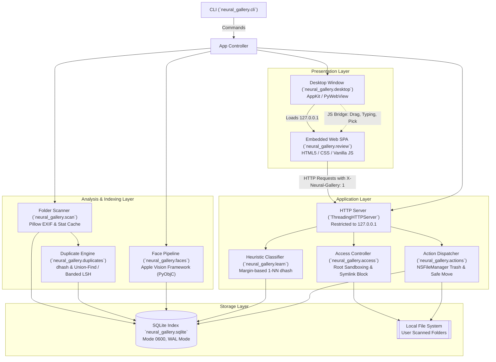

# Neural Gallery Documentation Hub

Welcome to the technical documentation for **Neural Gallery**, a local, privacy-first photo indexing and culling application engineered natively for macOS.

This documentation suite is structured for **human developers** seeking deep architectural insight and **AI coding agents** requiring precise schemas, invariants, and symbol mappings.

---

## 📚 Documentation Index

| Document | Primary Audience | Description |
| :--- | :--- | :--- |
| **[System Architecture](ARCHITECTURE.md)** | Developers & Agents | End-to-end system topology, module breakdown, data flows, and macOS AppKit/Vision integration. |
| **[Database Schema & Models](DATABASE_SCHEMA.md)** | Developers & Agents | SQLite DDL, indexing strategies, schema migrations, and optimized query access patterns. |
| **[HTTP API & Bridge Reference](API_REFERENCE.md)** | Developers & Agents | Comprehensive specification of the localhost REST API, security headers, payloads, and PyWebView JS bridge. |
| **[Core Algorithms & Vision Pipeline](CORE_ALGORITHMS.md)** | Developers & Researchers | Mathematical formulations of Difference Hashing (dhash), Union-Find/Banded LSH, Vision coordinate inversion, and face clustering. |
| **[Security & Privacy Architecture](SECURITY_AND_PRIVACY.md)** | Security Engineers & Agents | Path sandboxing (`allowed_file`), POSIX permission hardening (`0600`), and non-destructive macOS Trash guarantees. |
| **[Developer & Contributor Guide](DEVELOPER_GUIDE.md)** | Human Developers | Local development environment setup, PyObjC dependencies, test execution, CLI usage, and extension patterns. |
| **[AI Agent Context & Operational Manual](AGENT_GUIDE.md)** | AI Coding Agents | High-density symbol catalog, strict architectural invariants, AST maps, and modification recipes. |
| **[AI Vault Roadmap & Spec Bridge](ROADMAP_AI_VAULT.md)** | Architects & Planners | Analysis of Neural Gallery v0.2.0 vs. the future zero-knowledge encrypted gallery specification with Core ML and P2P Wi-Fi sync. |

---

## 🏛️ System Topology Snapshot



---

## 📁 Repository Directory Map

```
neural-gallery/
├── .github/
│   └── CODEOWNERS                  # Pull request review requirements (@pratham1659)
├── assets/
│   ├── AppIcon.icns                # macOS application bundle icon
│   └── AppIcon.png                 # Web & PyWebView desktop window icon (42x42 / 512x512)
├── docs/                           # Comprehensive technical documentation suite
│   ├── INDEX.md                    # Documentation hub (this file)
│   ├── ARCHITECTURE.md             # System architecture & component blueprints
│   ├── DATABASE_SCHEMA.md          # SQLite tables, indexes, and query specifications
│   ├── API_REFERENCE.md            # REST API endpoints & PyWebView JS bridge
│   ├── CORE_ALGORITHMS.md          # Algorithms: dhash, Union-Find, Vision, Centroids
│   ├── SECURITY_AND_PRIVACY.md     # Sandboxing, permissions, Trash invariants
│   ├── DEVELOPER_GUIDE.md          # Setup, testing, and contribution instructions
│   ├── AGENT_GUIDE.md              # AI agent instructions, invariants, and symbols
│   └── ROADMAP_AI_VAULT.md         # Comparison to the encrypted Mac Silicon spec
├── neural_gallery/                 # Core Python application package
│   ├── __init__.py                 # Package version definition (v0.2.0)
│   ├── access.py                   # Path sandboxing and root authorization
│   ├── actions.py                  # Trash, move, reveal, and index pruning
│   ├── cli.py                      # Argument parsing and command orchestration
│   ├── db.py                       # SQLite connection, DDL schema, and migrations
│   ├── desktop.py                  # Native AppKit Cocoa chrome and PyWebView window
│   ├── duplicates.py               # 64-bit dhash hamming clustering & banded LSH
│   ├── faces.py                    # Apple Vision face detection and feature print grouping
│   ├── learn.py                    # Nearest-example margin suggestion heuristic
│   ├── review.py                   # Localhost HTTP server and embedded SPA frontend
│   └── scan.py                     # Directory crawling, Pillow EXIF, and dhash indexing
├── tests/                          # Automated unit test suite
│   ├── test_actions.py             # Crop geometry, safe moves, duplicate/face groupings
│   ├── test_desktop.py             # AppKit borderless chrome and keyboard mechanics
│   └── test_neural_gallery.py      # Screenshots, scan cycles, dhash learning, HTTP API
├── LICENSE                         # MIT License
├── pyproject.toml                  # PEP 518/621 build configuration and dependencies
├── README.md                       # User-facing introduction and command reference
└── mac_silicon_encrypted_gallery_ai_vault_specification.md # Future architecture specification
```

---

## ⚡ Quick Reference

### Command Line Interface

```bash
# Scan a folder of images into the index
neural-gallery scan ~/Pictures/Vacation

# Inspect current database metrics
neural-gallery stats

# Detect and cluster faces using Apple Vision
neural-gallery faces

# Launch the desktop native window
neural-gallery app

# Run the review server headlessly in a browser
neural-gallery serve --port 8765
```

### Review Interface Keyboard Shortcuts

| Shortcut | Action | Description |
| :--- | :--- | :--- |
| `K` | **Keep** | Marks current photo as kept (`label = 'keep'`) |
| `N` | **Noise** | Marks current photo as noise (`label = 'noise'`) |
| `S` | **Skip** | Skips photo in current review session |
| `Left Arrow` (`←`) | **Previous** | Returns to the previous photo in history |
| `Right Arrow` (`→`) | **Next** | Advances to the next photo in queue |

### Default Filesystem Paths

* **Database File:** `~/Library/Application Support/Neural Gallery/neural_gallery.sqlite` (POSIX mode `0600`)
* **Database WAL:** `~/Library/Application Support/Neural Gallery/neural_gallery.sqlite-wal` (POSIX mode `0600`)
* **Database SHM:** `~/Library/Application Support/Neural Gallery/neural_gallery.sqlite-shm` (POSIX mode `0600`)
* **Local Web Server:** `http://127.0.0.1:8765`

