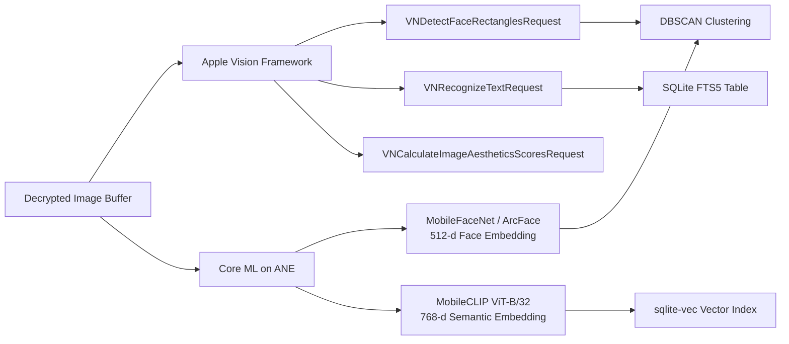
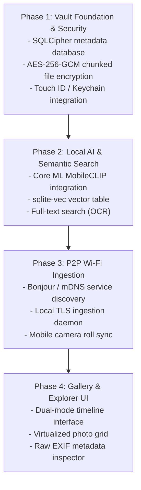

# AI Vault Evolution & Roadmap Specification

This document provides a comparative analysis and architectural roadmap connecting current **Neural Gallery (v0.2.0)** with the proposed **Encrypted Local Gallery & AI Vault for Mac Silicon** (`mac_silicon_encrypted_gallery_ai_vault_specification.md`).

---

## 1. Executive Summary & Vision

Current Neural Gallery is an on-device photo triage and culling tool built with Python, SQLite, and Apple Vision. The **AI Vault Specification** outlines the next major evolutionary phase: transforming Neural Gallery into a zero-knowledge, hardware-accelerated personal media vault with natural language semantic search, encrypted storage at rest, and peer-to-peer Wi-Fi synchronization for iOS and Android.

---

## 2. Comparative Architectural Matrix

| Architectural Dimension | Current Neural Gallery (v0.2.0) | AI Vault Target Architecture |
| :--- | :--- | :--- |
| **Language & Runtime** | Python 3.11+, PyObjC, PyWebView | Swift / C++ Native Engine + React Native macOS (or Tauri) |
| **At-Rest Encryption** | Plain media files on disk; SQLite DB protected by POSIX `0600` permissions. | **Zero-Knowledge Encryption:** Media encrypted via **AES-256-GCM** / **XChaCha20-Poly1305** (`.enc` chunks). Encrypted metadata via **SQLCipher** (`op-sqlite`). |
| **Key Management** | System user account credentials. | Master key derived via **Argon2id** (64MB, 3 iter, 4 lanes). Hardware unlock via **macOS Secure Enclave / Keychain** (`.userPresence` Touch ID). |
| **Semantic & Text Search** | Heuristic screenshot rules; no natural language understanding. | **MobileCLIP (ViT-B/32)** on Apple Neural Engine (ANE) producing 768-d embeddings. Vector similarity search via **`sqlite-vec`**. OCR text in SQLite **FTS5**. |
| **Face Recognition** | Apple Vision `VNGenerateImageFeaturePrintRequest` (512-d) with online centroid clustering. | Core ML **ArcFace** / **MobileFaceNet** (512-d) with **DBSCAN** spatial clustering ($\text{threshold} \ge 0.68$). |
| **Media Ingestion** | Local folder crawler (`rglob`) reading directories on Mac disks. | **Decentralized Wi-Fi Ingestion:** Local network Bonjour/mDNS (`_photovault._tcp`), mTLS / 6-digit numeric PIN, direct background upload from mobile companion apps. |
| **User Interface** | Embedded Single Page Application (HTML/CSS/JS) inside PyWebView; single-photo review canvas. | **Dual-Mode UX:** Google Photos-style pinch-to-zoom timeline (`@shopify/flash-list`) + Finder-style raw EXIF inspector. |

---

## 3. Subsystem Evolution Breakdown

### 3.1. Storage & Encryption Migration

```
Current (v0.2.0):
Original File on Disk ────────► Memory Decode ────────► Thumbnail & Index (SQLite)

Target (AI Vault):
User Password / Touch ID ─────► Secure Enclave ───────► Master Key in RAM
                                                           │
                                        ┌──────────────────┴──────────────────┐
                                        ▼                                     ▼
Incoming Media ─────────► Decrypt in Memory ──────► AES-256-GCM (.enc)   SQLCipher DB
```

* **Transition Path:**
  1. Replace `sqlite3` connection handler with `sqlcipher3` or embedded SQLCipher C-extension.
  2. Implement an in-memory streaming cipher (`cryptography.hazmat.primitives.ciphers.aead.AESGCM`) that generates per-file initialization vectors (IVs) and writes encrypted binary blobs to `~/Library/Application Support/SecureGallery/vault/`.
  3. Integrate `LocalAuthentication` framework via PyObjC to prompt for Touch ID on vault unlock.

### 3.2. Local AI & Apple Neural Engine Pipeline

Current Neural Gallery relies on Apple Vision's general image feature prints. The AI Vault introduces specialized Core ML models compiled for the Apple Neural Engine (ANE):



* **Natural Language Search Example:**
  When a user searches *"photos of dogs on the beach"*:
  1. The text query is converted into a 768-d vector via Core ML MobileCLIP text encoder.
  2. `sqlite-vec` executes a $K$-NN vector distance query against `vec_embeddings`.
  3. Ranked results return in $< 15\text{ms}$ without external API calls.

### 3.3. Peer-to-Peer Mobile Ingestion Engine

To ingest photos directly from mobile devices without cloud intermediaries:
* **Service Advertisement:** A background daemon advertises `_photovault._tcp.local.` via `NSNetService` on a dynamically assigned port.
* **Mutual Authentication:** A pairing handshake presents a 6-digit numeric PIN on the Mac display. The mobile companion app enters the PIN to establish an authenticated TLS session.
* **Chunked Streaming:** Media binaries (including high-resolution 48MP ProRAW and HEIC files) stream directly over local Wi-Fi, are encrypted in-flight, and are committed to the vault.

---

## 4. Phased Implementation Roadmap



1. **Phase 1: Security & Storage Hardening**
   * Introduce SQLCipher database layer.
   * Implement authenticated chunked encryption for image storage.
   * Add macOS Keychain unlock with Touch ID fallback.
2. **Phase 2: Apple Neural Engine & Semantic Vector Search**
   * Integrate `sqlite-vec` extension into SQLite.
   * Deploy MobileCLIP and MobileFaceNet Core ML packages.
   * Replace 1-NN dhash suggestion with semantic vector clustering.
3. **Phase 3: Decentralized Mobile Synchronization**
   * Build local Bonjour daemon advertising `_photovault._tcp`.
   * Create TLS upload handler with numeric PIN verification.
   * Implement companion export tool for iOS camera roll.
4. **Phase 4: Next-Generation Timeline Interface**
   * Build high-performance virtualized timeline grid with pinch-to-zoom transitions (Years/Months/Days).
   * Integrate dual-view toggle between Google Photos timeline and Finder-style raw file inspector.

