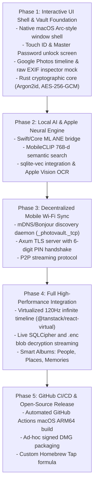

# Encrypted Local Gallery & AI Vault for Mac Silicon
## Comprehensive Architecture, Technology Evaluation & Implementation Plan

> **Project Goal:** Build an ultra-fast, zero-knowledge encrypted media vault for Apple Silicon featuring Google Photos-style timeline navigation, natural language semantic search, face recognition, and peer-to-peer mobile Wi-Fi synchronization.  
> **Open Source Distribution:** Distributed 100% free on GitHub without requiring a paid Apple Developer Account ($99/year).

---

## 1. Technology Evaluation: Swift vs. React Native vs. Tauri v2 (Rust)

A central architectural decision is choosing the right desktop foundation. Below is the detailed comparative analysis:

| Criteria | Option A: React Native macOS | Option B: Pure Swift (SwiftUI + AppKit) | Option C (Recommended): Tauri v2 (Rust + React) |
| :--- | :--- | :--- | :--- |
| **Runtime & Performance** | Heavy. Runs JavaScriptCore/Hermes + React Native bridge. | Extremely fast. Native compiled binary with direct Metal/GPU access. | **Fastest backend.** Rust compiled to native ARM64 with zero-cost abstractions; UI rendered via macOS WebKit (`WKWebView`). |
| **Memory & Security** | Garbage-collected memory. Hard to guarantee decrypted image buffers and cryptographic keys are zeroed out of RAM. | Manual memory management possible, but Swift ARC can retain buffers in memory pools. | **Best-in-class security.** Rust's `zeroize` trait guarantees sensitive buffers, IVs, and keys are scrubbed from RAM immediately when dropped. |
| **Apple Native Frameworks (`Vision`, `CoreML`, `LocalAuthentication`)** | Complex and brittle. Requires writing custom C++/Objective-C++ Turbo Modules. | **First-class native.** Apple's Swift APIs for Vision, CoreML, and Touch ID are native and immediate. | **Seamless via FFI.** Rust communicates directly with Objective-C/Swift frameworks via `objc2` or a thin Swift static library. |
| **UI Ecosystem & Virtualization** | Fragile. `react-native-macos` is a Microsoft-maintained fork that frequently lags behind upstream React Native. | Native macOS controls, but building complex virtualized masonry photo grids in SwiftUI can hit performance bottlenecks. | **Vast & mature.** Access to the entire modern web ecosystem (`@tanstack/react-virtual`, Tailwind CSS, Lucide icons, KaTeX, MapLibre). |
| **Binary Size & RAM** | 80–120 MB binary; 150–300 MB RAM. | ~10–20 MB binary; 40–80 MB RAM. | **~15 MB binary; 40–70 MB RAM.** |
| **Open Source Build without Paid Dev Account** | Painful. Xcode provisioning and CocoaPods dependencies frequently break for community contributors. | Requires Xcode, but builds cleanly with ad-hoc signing. | **Frictionless.** Compiles via `cargo tauri build` on standard GitHub Actions runners with no Xcode license hurdles. |

### Architectural Decision: Why Tauri v2 (Rust) + React Wins
1. **Why NOT React Native macOS:** `react-native-macos` introduces heavy build complexity (CocoaPods, Metro bundler, out-of-tree React forks), high memory overhead, and complicated FFI for Core ML / Vision. It is not suitable for a lightweight, privacy-focused desktop application.
2. **Why Tauri v2 over Pure Swift:** While pure Swift is fantastic for Apple-only tooling, Rust provides unmatched cryptographic ergonomics (`zeroize`, `aes-gcm`, `argon2`), effortless cross-platform potential (enabling the same core logic for mobile companion sync), and gives us the rich web ecosystem for virtualized timeline zooming.
3. **The Hybrid Native Bridge:** For Apple Silicon-specific acceleration (Apple Neural Engine and Apple Vision), Rust will interface with a lightweight native Swift bridge module.

---

## 2. Zero-Cost Open Source Distribution Strategy (No Apple Developer Account)

Without paying Apple $99/year for a Developer ID certificate, macOS Gatekeeper flags downloaded DMGs as untrusted. Here is the open-source distribution plan:

### 2.1. Ad-Hoc Signing (ARM64 Mandatory)
Apple Silicon Macs require all binaries to possess at least an ad-hoc signature to execute:
```bash
codesign --force --deep --sign - "NeuralGalleryVault.app"
```
Tauri's macOS bundler handles ad-hoc signing automatically during local and CI/CD builds.

### 2.2. Gatekeeper Quarantine Mitigation
When users download `NeuralGalleryVault.dmg` from GitHub Releases, macOS applies the `com.apple.quarantine` attribute. Neural Gallery will provide three clear onboarding paths:

1. **GUI Onboarding (Right-Click Open):**  
   Instruct users in the DMG background and README:
   * Right-click (or `Control`-click) `NeuralGalleryVault.app` $\to$ Click **Open** $\to$ Confirm **Open**.
2. **Terminal Quick-Command:**  
   Provide a one-line terminal command in the GitHub release notes:
   ```bash
   xattr -cr /Applications/NeuralGalleryVault.app
   ```
3. **Community Homebrew Tap (Recommended):**  
   Create a `homebrew-tap` repository (`brew install yourname/tap/neural-gallery-vault`). Homebrew automatically manages installation, updates, and quarantine exemptions.

### 2.3. Native Capabilities Available Without a Developer Account
* ✅ **Touch ID / Passcode:** `LocalAuthentication` framework (`LAContext.evaluatePolicy`) functions locally on any Mac without developer entitlement profiles.
* ✅ **Apple Neural Engine (ANE):** Core ML and Apple Vision run at full hardware speed without licensing constraints.
* ✅ **Local Keychain:** Hardware-backed keychain storage under `.userPresence` is available to ad-hoc signed binaries.

---

## 3. System & Cryptographic Architecture

```
User Master Password / Touch ID
            │
            ▼
[macOS LocalAuthentication / Keychain]
            │ (Releases Master Key into Secure Memory)
            ▼
    [Master Key (RAM with Zeroize)]
      ├── SQLCipher Encryption Key ────────► [Encrypted Metadata DB]
      └── File Streaming Cipher Key ───────► [Encrypted Media Blobs (.enc)]
```

### 3.1. Cryptographic Specifications
* **Key Derivation Function (KDF):** Master key derived via **Argon2id** (memory: 64 MB, iterations: 3, parallelism: 4) using a unique system salt.
* **Storage Encryption at Rest:**
  * Raw images are never saved unencrypted to disk.
  * Payloads are encrypted via **AES-256-GCM** using unique per-file 96-bit initialization vectors (IVs).
  * Encrypted files are stored as `.enc` chunks in `~/Library/Application Support/NeuralGalleryVault/vault/`.
* **Memory Hygiene:** Plaintext image buffers, decrypted thumbnails, and cipher keys implement `ZeroizeOnDrop` to prevent memory scraping attacks.

### 3.2. Database Schema (SQLCipher + sqlite-vec)

```sql
-- Encrypted Core Media Catalog
CREATE TABLE media_assets (
    id TEXT PRIMARY KEY,
    filename TEXT NOT NULL,
    storage_path TEXT NOT NULL,       -- Path to .enc file
    file_size INTEGER NOT NULL,
    mime_type TEXT NOT NULL,
    width INTEGER,
    height INTEGER,
    captured_at DATETIME,
    created_at DATETIME DEFAULT CURRENT_TIMESTAMP,
    latitude REAL,
    longitude REAL,
    altitude REAL,
    city TEXT,
    country TEXT,
    aesthetic_score REAL,
    is_favorite INTEGER DEFAULT 0
);

-- Face Recognition Entities
CREATE TABLE persons (
    id TEXT PRIMARY KEY,
    name TEXT,
    cover_face_id TEXT,
    created_at DATETIME DEFAULT CURRENT_TIMESTAMP
);

CREATE TABLE face_instances (
    id TEXT PRIMARY KEY,
    asset_id TEXT NOT NULL REFERENCES media_assets(id) ON DELETE CASCADE,
    person_id TEXT REFERENCES persons(id) ON DELETE SET NULL,
    box_x REAL,
    box_y REAL,
    box_width REAL,
    box_height REAL,
    embedding BLOB NOT NULL            -- 512-d float array (MobileFaceNet)
);

-- Full-Text Search (OCR Text from Images)
CREATE VIRTUAL TABLE asset_ocr USING fts5(
    asset_id UNINDEXED,
    recognized_text
);

-- Natural Language Semantic Search Vector Table (sqlite-vec)
CREATE VIRTUAL TABLE vec_embeddings USING vec0(
    asset_id TEXT PRIMARY KEY,
    embedding FLOAT[768]              -- 768-d MobileCLIP embedding
);
```

---

## 4. Local AI Pipeline (Apple Neural Engine Acceleration)

All AI inference executes locally using Apple Silicon hardware:

```
Incoming Decrypted Image Buffer
               │
      ┌────────┴──────────────────────────┐
      ▼                                   ▼
[Apple Vision Framework]         [Core ML Framework (ANE)]
 ├── VNDetectFaceRectanglesRequest ├── ArcFace / MobileFaceNet (512-d)
 │    └─ Face bounding boxes       │    └─ Face recognition clustering
 ├── VNRecognizeTextRequest        └── MobileCLIP (ViT-B/32, 768-d)
 │    └─ On-device OCR into FTS5        └─ Natural language semantic search
 └── VNCalculateImageAestheticsScoresRequest
      └─ Sharpness / Quality curation
```

### 4.1. Natural Language Semantic Search
1. During indexing, **MobileCLIP (ViT-B/32)** calculates a normalized 768-dimensional visual embedding on the Apple Neural Engine.
2. When the user enters an arbitrary search query (e.g. *"golden retriever playing in snow"* or *"tax receipt from last year"*):
   * Core ML translates the text prompt into a 768-dimensional text embedding.
   * `sqlite-vec` executes a $K$-NN cosine distance query against `vec_embeddings`.
   * Ranked results display in $< 15\text{ms}$ with zero manual tagging.

### 4.2. Face Clustering Workflow
1. Detect faces using `VNDetectFaceRectanglesRequest`.
2. Extract face crops with 25% contextual padding.
3. Generate 512-dimensional feature vectors via **MobileFaceNet** inside Core ML.
4. Execute **DBSCAN** clustering:
   $$\text{Cosine Similarity} = \frac{\mathbf{u} \cdot \mathbf{v}}{\|\mathbf{u}\|_2 \|\mathbf{v}\|_2} \ge 0.68$$
   Matching vectors join existing person clusters; distinct faces spawn new clusters.

---

## 5. Peer-to-Peer Mobile Ingestion Engine (Wi-Fi Sync)

```
[ Mobile Companion App (iOS / Android) ]
  │
  ├── 1. Discovers Mac via Bonjour/mDNS (_photovault._tcp)
  ├── 2. Connects to Mac Local IP via TLS
  └── 3. Transmits 6-digit PIN handshake
            │
            ▼ (Local Wi-Fi Network)
            │
[ Mac Silicon Embedded Ingestion Daemon (Axum / Rust) ]
  ├── 1. Validates pairing PIN
  ├── 2. Parses EXIF & metadata in memory
  ├── 3. Encrypts payload via AES-256-GCM
  ├── 4. Writes .enc file to disk
  └── 5. Dispatches background task to AI extraction queue
```

* **Zero Cloud Dependency:** Data never traverses third-party servers.
* **Format Flexibility:** Streams high-resolution HEIC, JPEG, and 48MP Apple ProRAW files directly.

---

## 6. Dual-Mode User Interface Specifications

### View Mode A: Google Photos Timeline Experience
* **Pinch-to-Zoom Grid:** Seamless zooming between **Years $\leftrightarrow$ Months $\leftrightarrow$ Days** powered by `@tanstack/react-virtual` at 120Hz ProMotion refresh rates.
* **Sticky Date Headers:** Human-readable timelines with reverse-geocoded spatial badges (e.g. *"September 18, 2026 • Cupertino, CA"* using an offline SQLite GeoNames database).
* **Smart Albums:**
  * **People & Pets:** Face-clustered avatar view with name editing.
  * **Places:** Interactive offline map pins.
  * **Categories:** Auto-curated collections (Receipts, Screenshots, Landscapes, Food).
  * **Memories:** Automated "On This Day" cards.

### View Mode B: File Manager & EXIF Inspector
* **Tree View:** Traditional hierarchy displaying folders, storage structures, and manual tags.
* **Raw Inspector:** Detailed slide-over panel displaying camera make, lens model, focal length, ISO, aperture, shutter speed, and exact GPS coordinates.
* **Batch Operations:** Safe batch renaming and export tools.

---

## 7. Phased Implementation Roadmap



### Phase 1: Interactive UI Shell & Vault Foundation
* **Scope:**
  * **Interactive Visual UI & Design System:**
    * Build the native macOS desktop shell with transparent titlebars and traffic light controls.
    * Build the biometric **Touch ID & Master Password Unlock Screen** with smooth unlock animations.
    * Implement the **Dual-Mode Experience Prototype**:
      1. *Timeline View:* Year/Month/Day zooming, sticky date badges, semantic search bar, and photo cards with encrypted indicators.
      2. *Finder Explorer View:* Folder tree, asset list, and slide-over **Raw EXIF & GPS Inspector**.
  * **Cryptographic Foundation Core (Rust):**
    * Scaffold Tauri v2 workspace with a modular Rust core.
    * Implement AES-256-GCM chunked file streamer (`aes-gcm`, `zeroize`).
    * Implement Argon2id password derivation and macOS Touch ID unlock (`security-framework` / `LocalAuthentication`).
    * Integrate SQLCipher with initial `media_assets` and `tags` tables.
* **Milestone:** An executable desktop application where you can experience the exact look, feel, and navigation of Neural Gallery Vault, unlock it with password/Touch ID, switch views, and inspect metadata.

### Phase 2: Local AI & Apple Neural Engine Integration
* **Scope:**
  * Build a lightweight Swift static bridge linking Apple Vision and Core ML.
  * Deploy MobileCLIP (ViT-B/32) and MobileFaceNet compiled for the Apple Neural Engine.
  * Integrate `sqlite-vec` into SQLCipher for vector search.
  * Implement DBSCAN face clustering and OCR text indexing into FTS5.
* **Milestone:** CLI capable of natural language queries (`neural-gallery query "sunset over water"`) and face groupings.

### Phase 3: Decentralized Local Wi-Fi Sync Daemon
* **Scope:**
  * Implement Bonjour/mDNS service discovery (`_photovault._tcp.local.`).
  * Build an Axum-based local HTTPS server with pairing PIN validation.
  * Handle chunked multipart streaming of camera roll assets.
* **Milestone:** Mobile devices can discover the Mac on local Wi-Fi and stream photos into the encrypted vault.

### Phase 4: Full High-Performance Integration
* **Scope:**
  * Connect the virtualized 120Hz React timeline directly to real encrypted `.enc` blobs and thumbnail caches.
  * Implement offline reverse geocoding map pins for the Places album.
  * Finalize the People & Pets cluster editor with face renaming.
* **Milestone:** Seamless, production-ready desktop experience managing tens of thousands of encrypted photos.

### Phase 5: CI/CD & Zero-Cost GitHub Distribution
* **Scope:**
  * Set up GitHub Actions workflow on `macos-14` (Apple Silicon runners).
  * Automate DMG creation with custom background and ad-hoc code signing.
  * Write clear user instructions for Gatekeeper bypass (`xattr -cr`).
  * Launch a community Homebrew tap repository (`homebrew-tap`).
* **Milestone:** Public GitHub release with automated DMG downloads and one-line Homebrew installation.
